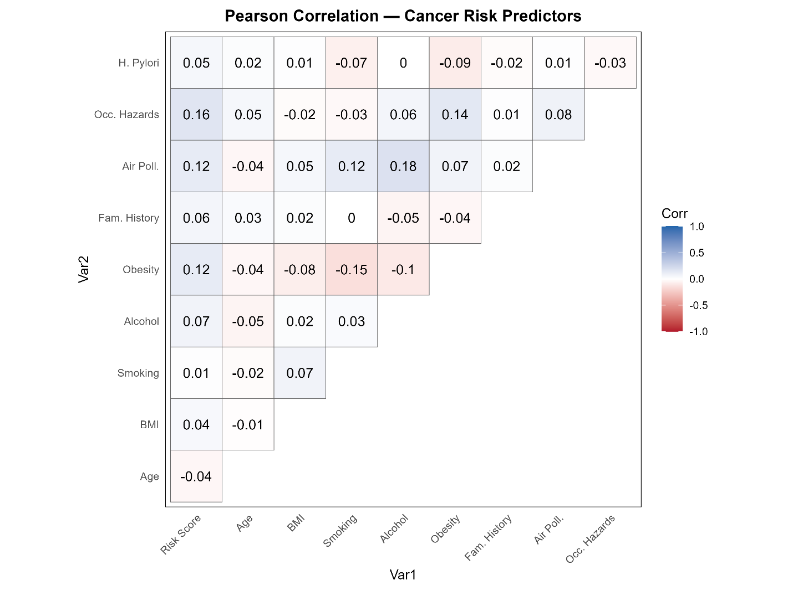
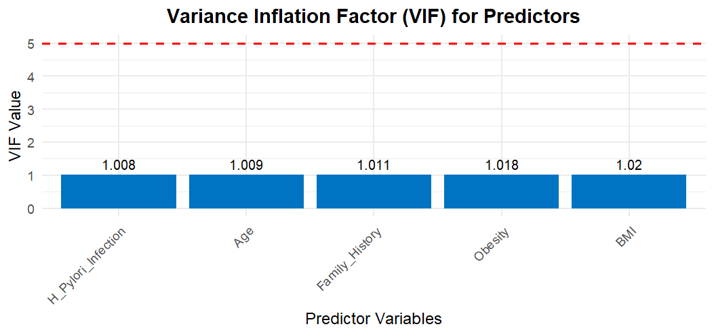
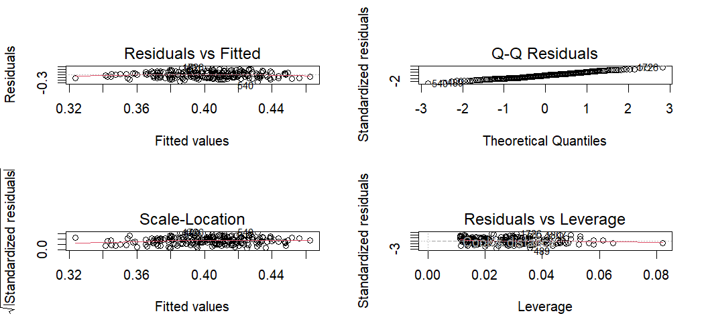

# Cancer Risk Score Prediction: Multiple Linear Regression in R

Cancer risk comes from a mix of lifestyle, genetic and environmental factors. This project asks: **can measurable factors such as age, BMI, family history and infection status predict a person's overall cancer risk score?** If they can, public health teams could use the model to decide where to target screening and prevention.

**Tools:** R (tidyverse, broom, car, Metrics, ggplot2, ggcorrplot, flextable)  
**Methods:** data cleaning, descriptive statistics, Pearson correlation, multiple linear regression, interaction and quadratic terms, ANOVA model comparison, VIF, residual diagnostics, R², RMSE, MAE

---

## Key findings

| Finding | Result |
|---|---|
| Significant predictors | **Family history** (p = 0.006) and **H. pylori infection** (p = 0.036) were linked to higher risk scores |
| Age and BMI | Not significant once other factors were held constant (p = 0.082 and p = 0.119) |
| Interaction terms (Age × BMI, BMI × Obesity) | Did not improve the model (ANOVA F = 1.28, p = 0.281) |
| Squared terms (Age², BMI²) | Did not improve the model (ANOVA F = 1.93, p = 0.148) |
| Multicollinearity | None: all VIF values between 1.008 and 1.020 |
| Model fit | Low: the factors explain **under 5%** of the variation in risk scores |

**Main takeaway:** a few factors are clearly linked to higher risk, but the available variables explain very little of the overall variation. Other factors, many of them not captured in this dataset, matter more. Reporting that limit clearly is part of the result.

---

## Data

- **Source:** [Cancer Risk Factors & Types dataset, Kaggle](https://www.kaggle.com/datasets/tarekmasryo/cancer-risk-factors-dataset)
- **Size:** 2,000 individual records and 21 features
- **Response variable:** `Overall_Risk_Score`, a composite risk score from 0 to 1 (mean 0.45, SD 0.12)
- **Predictors explored:** age (mean 63), BMI (mean 26.2), smoking, alcohol use, obesity, family history, air pollution, occupational hazards and H. pylori infection
- **Cleaning:** removed the patient ID, converted Yes/No fields to 1/0, and converted numeric fields. Several lifestyle and environmental variables had missing values, so the models use the variables with complete data.

The dataset is not stored in this repository. Download `cancer-risk-factors.csv` from the Kaggle link above to run the code.

---

## Approach

1. **Explore** the data with means, standard deviations, box plots and a Pearson correlation heatmap.
2. **Fit** a multiple linear regression of the risk score on age, BMI, family history and H. pylori infection, using all 2,000 records.
3. **Test** whether interaction terms (Age × BMI, BMI × Obesity) or squared terms (Age², BMI²) improve the model, using ANOVA comparisons.
4. **Check** the final model with VIF for multicollinearity and four residual diagnostic plots.
5. **Evaluate** with R², adjusted R², RMSE and MAE.

---

## Model results

**Regression on all 2,000 records**

| Predictor | Coefficient | p-value |
|---|---|---|
| Age (per year) | −0.00046 | 0.082 |
| BMI (per unit) | 0.00108 | 0.119 |
| Family history (yes vs no) | 0.0190 | **0.006** |
| H. pylori infection (yes vs no) | 0.0145 | **0.036** |

R² = 0.0085, adjusted R² = 0.0065. The model as a whole is significant (F = 4.27, p = 0.0019), but it explains less than 1% of the variation.

**Final model with obesity added (records with complete data)**

| Metric | Value |
|---|---|
| R² | 0.0496 |
| Adjusted R² | 0.0272 |
| RMSE | 0.1094 |
| MAE | 0.0903 |

---

## Model checks

- **VIF:** all values were close to 1, well below the usual limit of 5, so the predictors are not redundant.
- **Residual diagnostics:** the residuals vs fitted, Q-Q, scale-location and leverage plots showed no major problems with linearity, normality or constant variance, and no highly influential points.

---

## Limitations

- **Association, not cause.** The model shows which factors go together with higher risk scores, not what causes cancer.
- **Low explanatory power.** The model explains under 5% of the variation, so it is useful for understanding factors, not for predicting an individual's risk.
- **Missing data.** Smoking, alcohol use, diet and environmental exposures had missing values and could not all be used.
- **Composite score.** The risk score is built into the dataset, and how it was calculated is not fully known.

## Next steps

- Handle missing values with imputation so more risk factors can be included
- Try models that capture complex patterns, such as random forests
- Predict the risk level (Low, Medium, High) or cancer type with a classification model

---

## Repository contents

| File | Description |
|---|---|
| `cancer_risk_analysis.R` | R code for cleaning, analysis, modeling and charts |
| `Cancer_Risk_Report.docx` | Full written report with tables and interpretation |
| `correlation_heatmap.png`, `boxplots.png`, `vif_chart.png`, `diagnostic_plots.png` | Charts produced in R |

## How to run

1. Download `cancer-risk-factors.csv` from Kaggle (link above).
2. Open `cancer_risk_analysis.R` in RStudio.
3. Set your working directory to the folder that holds the CSV file.
4. Run the script from top to bottom. It installs any missing packages.

---

**Author:** Sharon Rosina Wamalwa, MS Business Analytics, University of South Dakota  
[LinkedIn](https://www.linkedin.com/in/rosina-sharon/)

*Completed as part of the Data Mining for Managers course (DSCI 724) at the University of South Dakota.*
